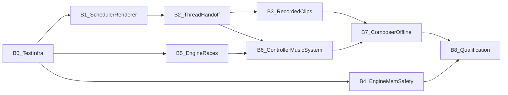
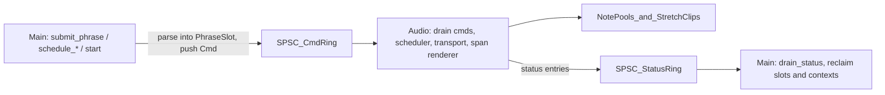

# Symphony bug-fix plan (post P0–P10 / N0–V1 review)

> Fixes found after P0–P10 and procedural music N0–V1. This file is the implementation plan. It does not replace [`tech-fix-plan.md`](tech-fix-plan.md) or [`proc-music-plan.md`](proc-music-plan.md).

## Progress (update every phase commit)

| Field | Value |
|---|---|
| **As of** | 2026-10-11 |
| **Branch** | `master` |
| **Done** | **B0**, **B1**, **B2**, **B3**, **B4** engine memory safety |
| **Next** | **B5** engine races and correctness |
| **C++ tests** | 342/342 `*Symphony*` green on `bin/godot.macos.editor.arm64` |

### Commits

| Phase | Commit | Notes |
|---|---|---|
| B0 | `0015d849eb` | Alloc counter, helpers, mixer scaffold |
| B1 | `8f09e10cc4` | Boundary carry, generation-scoped notes, span renderer |
| B2 | `5437887899` | SPSC command/status rings, phrase slots, atomic stretch, restart flag |
| B3 | `02bf112335` | Tempo-as-speed, Catmull-Rom resample, `register_clip_wav`, unclaimed clip return |
| B4 | *(this commit)* | Layout keys, SpectralGate exclusion, PhaseVocoder arena fn, note-only pristine |

## Finding to phase map

- **B1:** boundary drops; per-block allocations; tempo segment cap; past-tick tempo rescaling; MusicNoteInput same-block events and block-level gate; first-index voice steal; uninitialized `track_to_pool`; ignored `schedule_track_gain` timing; per-block snapshot cost.
- **B2:** main/audio races on scheduler, transport, `prepared_clips`, `latency_delay` and `track_gains`; dual-producer status ring; stretch ownership races; `replace_future` ignoring generation; restart touching audio state from main.
- **B3:** inverted tempo ratio and missing fractional accumulation; no resampling and the hard-coded 48k in GDScript; stretch context leak; cache re-registration out-of-bounds read and `MAX_CLIPS` leak; clip start alignment; unverified latency alignment.
- **B4:** FDN and GrainCloud migration out-of-bounds writes; SpectralGate migration; PhaseVocoder 8192 arena; custom Waveshaper pristine bound; unvalidated trigger offsets.
- **B5:** Oscillator and SVFilter reset gaps; reverb `params_shadow` race; spatial `slot_to_emitter` race; RTPC plain fields; `trigger_at` FIFO ordering; stale compile cache; free-list bypassed on retirement; budget accounting; ineffective BeatClock `fire_ahead_s`.
- **B6:** ignored statuses and missing fallback; BeatClock rate mismatch and early `set_bpm`; tempo retry loop; missing `transition_completed` / `state_changed`; `load_score` failure mode; procedural stream left assigned.
- **B7:** `chords[0]` only; `request_key` not applied to generated notes; polyphony validation by onset count; unbounded onsets; offline render stub.
- **B8:** stale signal docs; QUALIFICATION claims not backed by tests.

## Ground rules

- **Plan document.** Save this plan as [modules/symphony/bugfix-plan.md](modules/symphony/bugfix-plan.md) with a Progress block and a commits table, following [modules/symphony/tech-fix-plan.md](modules/symphony/tech-fix-plan.md). Update it on every phase commit, and add a one-line pointer to it in the tech-fix-plan Progress block.
- **Phase rule.** Each phase ends with both test suites green and the docs touched in that phase updated, and is committed on its own. Native and game-template changes go in separate commits.
- **Build:** `scons platform=macos target=editor arch=arm64 tests=yes module_raycast_enabled=no -j$(sysctl -n hw.ncpu)`
- **Tests:**
  - C++: `bin/godot.macos.editor.arm64 --headless --test --test-case='*Symphony*'`
  - TSan: run the same suite on the `.san` binary for the phases marked TSan below.
  - GDScript (in game-template): `node addons/agent_cli/gd.mjs test test/addons/symphony_audio`
- **No compatibility shims** (memory `symphony-presets-no-compat`). API changes go into `MIGRATION.md`.

## Phase order

B4 and B5 are independent of the music lane and can run in parallel once B0 is done.

## Target threading model for music (B1–B3)

After preparation, the main thread never touches the scheduler, transport, note pools, gains, prepared-clip table or latency buffer. Everything it wants to change goes through commands.

---

## B0: Test infrastructure (godot)

- **Allocation counter (DEV builds only).** Add a per-thread allocation counter to [core/os/memory.cpp](core/os/memory.cpp) / [core/os/memory.h](core/os/memory.h): `thread_local uint64_t` incremented in `alloc_static` and `realloc_static`, read through `Memory::get_thread_alloc_count()`, and compiled out in release builds. It's a small fork patch, like the existing `AudioStreamPlayer3D` one.
- **Helpers** in [tests/modules/symphony_test_helpers.h](tests/modules/symphony_test_helpers.h):
  - `SYMPHONY_CHECK_NO_ALLOC(expr)`;
  - `make_click_instrument()`, a MusicNoteInput driving an impulse, for onset detection;
  - `render_music(pb, frames, chunk)`;
  - `first_onset_frame(buf, threshold, from)`.
- **Test accessors** on `AudioStreamPlaybackSymphonyMusic`: `_test_active_voice_count()`, `_test_transport_segment_count()`, `_test_free_stretch_contexts()`.
- **Stress scaffold:** a mixer thread plus a main-thread loop, copying the pattern in [tests/modules/test_symphony_lifetime.cpp](tests/modules/test_symphony_lifetime.cpp).
- **Exit gate:** the helpers have their own small tests, and the suite is green.

## B1: Music scheduler and renderer correctness (godot, single-threaded)

**Files:**
- [modules/symphony/runtime/symphony_music_scheduler.h](modules/symphony/runtime/symphony_music_scheduler.h)
- [modules/symphony/runtime/symphony_music_transport.h](modules/symphony/runtime/symphony_music_transport.h)
- [modules/symphony/runtime/symphony_note_pool.h](modules/symphony/runtime/symphony_note_pool.h)
- [modules/symphony/nodes/io/symphony_music_note_input.h](modules/symphony/nodes/io/symphony_music_note_input.h)
- [modules/symphony/stream/audio_stream_playback_symphony_music.cpp](modules/symphony/stream/audio_stream_playback_symphony_music.cpp) and `.h`

**Steps:**

1. **Note identity per phrase.** Add `generation` to `SymphonyMusicEvent`. Voices store `(generation, note_id)` and `note_off` matches both, so ids can safely restart at 1 in every phrase.
2. **Boundary hand-off** (this fixes the dropped note-offs and dropped downbeats). Replace the current "swap at block start and discard the rest" logic in `advance()`:
   - events from `current` with `tick < next.start_tick` fire normally up to the boundary frame B;
   - the switch to `next` happens exactly at B, even mid-block, and `next` events at B fire;
   - note-offs from `current` with `tick >= next.start_tick` move into a fixed `carry_offs[512]` list, sorted by frame, and are always processed;
   - if the carry list overflows, the overflowing notes are released at B and a `note_forced_off` status is reported.
3. **Late phrase.** If B is already in the past, activate immediately, skip note-ons whose frame has passed, and push a new `phrase_late{generation, skipped}` status.
4. **Span renderer.** `_mix_internal` renders up to the next event frame (capped at 64 samples), applies every event at that frame (note-off before note-on), and continues. Event offsets are therefore always 0, which makes MusicNoteInput's FLOAT `gate` and `frequency` sample-accurate. This deletes the per-block `LocalVector pending` lists.
5. **No allocations on the audio thread.**
   - Fixed member arrays `synth_scratch[64]` and `track_scratch[64]` replace the two `Vector`s in `_render_block`.
   - `SymphonyNotePool::voices` becomes a fixed array of `MAX_VOICES`, and `tmp` becomes a member array.
   - Drop `current.sort_stable()` on the audio thread; phrases are sorted on main at submit.
6. **Transport.**
   - Fixed arrays replace `LocalVector`.
   - Segments that end before the current tick are folded into an anchor (`anchor_tick`, `anchor_seconds`), so the 64-segment cap is never reached.
   - Tempo or meter changes with `start_tick` earlier than the current tick are rejected, so elapsed history is never rescaled.
   - The transport snapshot is published once per `_mix_internal` call instead of every block.
   - `frame_to_tick` searches from the anchor.
7. **Timed track gains.** `schedule_track_gain` honours `start_tick` and `fade_ticks` through an audio-side per-track ramp (applied by command once B2 lands; direct in this phase).
8. **MusicNoteInput.** Keep up to 4 pending events per block, sorted by offset. `note_on` no longer clears an earlier pending off.
9. **Voice stealing.** Steal the oldest releasing voice, then the oldest active one (track `start_frame`), instead of index 0.
10. **Safety net.** Per-track `max_hold_seconds` (default 60) force-releases a stuck voice and reports `note_forced_off`.
11. **Initialization.** Fill `track_to_pool[256]` with -1 in the constructor, not only in `_clear_runtime`.

**Tests** (new file `tests/modules/test_symphony_music_boundary.cpp`):
- Back-to-back 4-bar phrases at 48k/120, 44.1k/120, 48k/128 and 44.1k/97:
  - every note releases, and the voice count returns to 0;
  - every phrase downbeat onset equals `tick_to_frame(start_tick)` exactly.
- A note held across a boundary releases at its own tick.
- A reused `note_id` in a new generation doesn't release the old phrase's voice.
- A late phrase reports `phrase_late`.
- A 10-minute offline render with 200 tempo changes: segment count stays bounded, no valid request is rejected, and active voices stay bounded.
- `SYMPHONY_CHECK_NO_ALLOC` around 5 s of `mix_graph_rate` with notes, tempo events and gain events.
- Extend the existing V1 `replace_future` test in [tests/modules/test_symphony_music_v1.cpp](tests/modules/test_symphony_music_v1.cpp) to render past both boundaries.

## B2: Music thread hand-off (godot, TSan)

1. **New `SymphonySpscRing<T, N>`** in `modules/symphony/core/symphony_spsc_ring.h`: trivially copyable T, power-of-two N, acquire/release indices.
2. **Phrase slots.** 4 slots, each with an atomic state: Free, Filled (main), Queued, Active (audio), Retired (audio). Main parses and sorts into a Free slot, then pushes `Cmd{SubmitPhrase, slot}`. Main reclaims Retired slots in `submit_phrase` and `drain_status`. With no Free slot, the call returns `ERR_BUSY`.
3. **Command ring** (capacity 64). Commands:
   - `SubmitPhrase`;
   - `ReplaceFuture{from_tick, generation}`, which only clears a pending phrase whose generation is at most the given one (`p_generation` is honoured now);
   - `TempoStep` / `TempoRamp`;
   - `TrackGain`;
   - `ClipPrepared{ctx, tick, generation, note_id}`;
   - `Reset`.

   A full ring returns `ERR_BUSY` and never partially publishes a phrase.
4. **Status rings.**
   - The audio-to-main SPSC ring has the audio thread as its only producer.
   - Statuses raised on main go into a main-only list that `drain_status` merges in.
   - Add an overflow counter so dropped statuses are counted, not silently lost.
5. **Stretch ownership** becomes `std::atomic<uint8_t>`: release stores on every transition, acquire loads on every read. `reclaim_returned()` only touches contexts in the Returning state.
6. **Prepared-clip table.** An audio-owned fixed array, filled by `ClipPrepared` commands, replaces `LocalVector prepared_clips`.
7. **Fixed latency.** All contexts use the music rate (after B3), so the common latency is computed once in `_prepare_pools()` from a probe stretch configured with `presetDefault(2, music_rate, true)`. `latency_delay` is allocated once and never resized at runtime.
8. **Restart.** `start()` only sets an atomic `restart_pending` flag plus `active`. The audio thread then resets the scheduler, idles all voices, returns active clips, and clears the delay buffer.
9. **Snapshot.** `get_transport_snapshot()` reads `generation` and `sample_rate` from the SeqLock snapshot instead of plain fields.

**Tests:**
- `[Symphony][Music][Stress]`: 3 s with a mixer thread against a main loop calling submit, tempo, gain, clip, `replace_future` and drain. Zero TSan reports in Symphony frames on the `.san` binary.
- A full ring returns `ERR_BUSY` with nothing published.
- `replace_future` with an older generation doesn't clear a newer phrase.
- A restart mid-playback silences the old voices.

## B3: Recorded clips (godot + game-template)

**Files:**
- [modules/symphony/runtime/symphony_music_stretch.h](modules/symphony/runtime/symphony_music_stretch.h)
- [modules/symphony/runtime/symphony_music_stereo_pcm.cpp](modules/symphony/runtime/symphony_music_stereo_pcm.cpp)
- [modules/symphony/stream/audio_stream_symphony_music.cpp](modules/symphony/stream/audio_stream_symphony_music.cpp)
- [/Users/luong.pham/Work/game-template/addons/symphony_audio/procedural/procedural_music_controller.gd](/Users/luong.pham/Work/game-template/addons/symphony_audio/procedural/procedural_music_controller.gd)

**Steps:**

1. **Tempo semantics.** Define `tempo_ratio` as playback speed (target BPM / source BPM), the same meaning `seek(playbackRate)` already uses.
   - `process_add` accumulates fractional source frames: `src_acc += frames * tempo_ratio; in_n = floor(src_acc); src_acc -= in_n`.
   - Scratch buffers are sized in `prepare()` to `ceil(64 * tempo_ratio_max) + 2` and the input latency. `process_add` never resizes (`DEV_ASSERT`).
2. **Resampling at registration.**
   - `register_clip_pcm(key, pcm, source_rate, ...)` resamples to `symphony_select_music_rate(device rate, or offline rate)`.
   - Use Catmull-Rom, shared with WavePlayer's `hermite4`, in place of linear `symphony_music_resample_to_stereo_float`.
   - Body markers are given in source frames and converted to the music rate.
   - Store `ClipConfig.music_rate`.
3. **New `register_clip_wav(key, AudioStreamWAV, source_bpm, body_start_s, body_end_s)`.** It decodes any WAV format through the existing P2 N3 path (`SymphonyWavePlayer::decode_to_pcm16`), then resamples as in step 2.
4. **Rate mismatch.** `instantiate_playback` marks clips whose `music_rate` differs from the playback rate as unusable and reports it once (the documented "rate change requires reload").
5. **Stereo cache.**
   - The cache key becomes `key|rate|frames|hash`.
   - Re-registering a user key with different content releases the old entry after the new one is acquired.
   - `desc.frames` always comes from the actual cache entry, which removes the out-of-bounds read.
   - Check `MAX_CLIPS` before `acquire`, which fixes the leaked reference.
6. **Unclaimed contexts.** The audio thread returns any prepared context whose phrase was replaced or never activated, or whose target frame is more than one block in the past. It reports `clip_returned`. This fixes the leak that blocks all clips after 8 cancellations.
7. **Sample-accurate clip start.** Clips start at the span boundary from B1, not at the block start.
8. **Latency alignment (test first).** Write the onset test before picking the compensation: a click clip and a click note scheduled at the same tick. Use `outputLatency` or input plus output latency, whichever gives an onset difference of at most 48 samples.
9. **GDScript.** `_register_recording_clips` calls `register_clip_wav` with the WAV's real rate. Delete `_load_wav_stereo_float` and `_read_i16`.

**Tests** (extend [tests/modules/test_symphony_music_n3.cpp](tests/modules/test_symphony_music_n3.cpp)):
- Tempo ratios 0.8, 1.0 and 1.25: duration equals source length / ratio within one block, and pitch is within ±5 cents.
- A 44.1k source at a 48k music rate: pitch within ±5 cents, duration within ±1 ms.
- 20 cancelled clip events: all contexts are Free after drain, and a 9th clip still plays.
- Re-registering longer PCM under the same key is ASan-clean.
- A `MAX_CLIPS` rejection leaves the cache entry count unchanged.
- The alignment test from step 8.
- GDScript: a real 44.1 kHz fixture WAV plays at the correct duration.

## B4: Engine memory safety (godot)

1. **Migration layout key.**
   - Add `virtual uint32_t get_state_layout_key() const { return 0; }` to `SymphonyOperator` and include it in `_structural_hash` in [modules/symphony/core/symphony_prepared_graph_package.cpp](modules/symphony/core/symphony_prepared_graph_package.cpp).
   - FDNReverb hashes `(num_lines, max_delay, max_pre_delay_samples)`.
   - GrainCloud hashes `capture_size`.
   - Also add defensive clamps in both `import_state` functions (write positions taken modulo capacity).
2. **SpectralGate:** `export_state` returns 0, so it's excluded from migration (documented, as already done for PhaseVocoder).
3. **PhaseVocoder:** replace the static `extra_arena_bytes` with `extra_arena_bytes_fn` returning `sizeof(float)*(10N + 5*(N/2+1)) + 13*32`. Delete the stale comment.
4. **Per-node pristine size.** Add `export_state_bytes_fn(params)` to `OperatorDescriptor`.
   - Move ModalBank's special case out of [modules/symphony/core/symphony_graph_compiler.cpp](modules/symphony/core/symphony_graph_compiler.cpp) (around lines 621–627) into its own function.
   - Waveshaper returns `12 + (custom ? 4*table_size : 0)`.
5. **Pristine state only for note voices.** Add a `CompileOptions{capture_pristine}` argument. `SymphonyNotePool` passes true; SFX and LOD compiles skip pristine planning and allocation. `reset_for_note` asserts the pristine blob exists.
6. **TriggerBuffer::push** clamps offsets into `[0, 63]`, with a DEV warning when it clamps.

**Tests:**
- FDN migration across room sizes and 44.1k/96k variants: ASan-clean with finite output.
- GrainCloud migration across `capture_seconds` variants.
- PhaseVocoder at `fft_size` 8192 compiles and runs.
- A custom-table Waveshaper compiles in an SFX graph and passes reset conformance inside a note pool.
- SFX arena sizes shrink once pristine is skipped.
- A TriggerBuffer clamp unit test.

## B5: Engine races and correctness (godot, TSan)

1. **Reset conformance gaps.**
   - Oscillator exports `triangle_primed`; raise its registry bound from 8 to 12.
   - SVFilter `import_state` invalidates cached coefficients and resets `silent_blocks` and `activity`.
   - Extend [tests/modules/test_symphony_operator_reset.cpp](tests/modules/test_symphony_operator_reset.cpp) with parameter variants per operator: all waveforms, SVF modulated before reset, Noise colours, custom Waveshaper.
2. **Reverb effect.** The instance keeps a `Params last_params`, seeded from the base in `instantiate()` on main. `process()` uses it when `try_load` fails and never reads `params_shadow` ([modules/symphony/effects/audio_effect_symphony_reverb.cpp](modules/symphony/effects/audio_effect_symphony_reverb.cpp), lines 66–78).
3. **Spatial map.** `read_params` and `try_read_params` read a fixed `std::atomic<int32_t> slot_emitter[MAX_SLOTS]` table that register/unregister publish. Confirm the slot bound against `SymphonyVoicePool` first. The `HashMap` stays main-only.
4. **RTPC.** `attack_ms`, `release_ms` and `sample_rate` become relaxed `std::atomic<float>`. Setters store them, then set `alphas_dirty` with a release store.
5. **trigger_at ordering.** The consumer moves queue entries into an audio-owned sorted pending array of 64, so a future entry no longer blocks the ones behind it. Add a `DEV_ASSERT` that `fire_at` runs on the main thread (single producer).
6. **Compile cache.**
   - Add `_mark_graph_dirty()` and call it from every mutator: `_set_graph_property`, `set_graph_for_tier`, `get_graph_for_tier_mut`, `load_test_graph*`, and the LOD add/duplicate/set/remove functions in [modules/symphony/stream/audio_stream_symphony.cpp](modules/symphony/stream/audio_stream_symphony.cpp).
   - For SubGraphs, the cache records `(ObjectID, graph_version)` for each flattened child and re-flattens when any of them changes.
7. **Free-list on retirement.** `PreparedGraphPackage` stores `ObjectID owner_stream`. `GraphPackageRetirement::drain()` calls `recycle_package()` when the owning stream is still alive, otherwise destroys the package.
8. **Budget accounting.**
   - Count `operator_types` in both the planned and the reconciled totals.
   - Reconcile `promotions_after_offsets` and `head_publish_ops` too.
   - `DEV_ASSERT` that the reconciled total equals the actual metadata bytes.
9. **BeatClock** ([modules/symphony/runtime/beat_clock.cpp](modules/symphony/runtime/beat_clock.cpp)):
   - add `update_transport(beat_position, bpm, beats_per_bar)` for PROCEDURAL mode;
   - in position-driven modes, compute crossings on `_get_corrected_time()` so `fire_ahead_s` and the latency correction take effect, while `target_time` stays the heard time.

**Tests:**
- TSan runs for reverb `set_room` and RTPC concurrency.
- `trigger_at` with frames 100 then 50 fires both at exact offsets.
- Each cache-invalidation path.
- Free-list reuse after an LOD retirement (no new arena allocations).
- Budget reconciliation.
- BeatClock beats fire `fire_ahead_s` early, and `update_transport` emits each beat once across a tempo ramp.

## B6: Controller and MusicSystem (game-template)

**Files:**
- [/Users/luong.pham/Work/game-template/addons/symphony_audio/procedural/procedural_music_controller.gd](/Users/luong.pham/Work/game-template/addons/symphony_audio/procedural/procedural_music_controller.gd)
- [/Users/luong.pham/Work/game-template/addons/symphony_audio/music_system.gd](/Users/luong.pham/Work/game-template/addons/symphony_audio/music_system.gd)

**Steps:**

1. **Submit on activation.** When the `phrase_activated(N)` status arrives, compose and submit phrase N+1 immediately, which gives a full phrase of slack. Keep the one-beat look-ahead as a backstop.
2. **Consume `drain_status`** instead of discarding it. Count drops, late phrases and forced note-offs, and expose them through a debug signal. On `phrase_late`, or when no activation arrives within one beat after the boundary, resubmit `last_ledger` (increment `fallback_count` and log the admitted tick).
3. **BeatClock.** Replace `update_playback_position(frame / stream.mix_rate)` with `BeatClock.update_transport(...)` fed from the snapshot. Remove the immediate `BeatClock.set_bpm` in the tempo path.
4. **Tempo failure.** A failed `schedule_tempo` warns once and clears the pending request, instead of retrying every frame.
5. **set_state signals.**
   - The controller's `set_state` returns a bool, and MusicSystem only emits `transition_started` for valid sections.
   - The controller emits `section_activated` when the phrase carrying the new section activates, and MusicSystem then emits `transition_completed` and `state_changed` (currently never emitted in procedural mode, see `music_system.gd` 243–255 and 912–936).
6. **load_score failure** restores the previous `_playback_mode` (lines 233–237).
7. **stop()** sets `player.stream = null` after stopping, including after the fade timer.
8. **Generation.** `replace_future` callers pass the current generation.

**Tests:** new `procedural_music_controller_test.gd`, plus extensions to the G2 tests:
- activation-driven submission;
- fallback on a simulated late phrase;
- `set_state` completion signals;
- `stop()` clears the stream;
- a failed tempo request doesn't loop;
- BeatClock beats match the transport across a tempo ramp.

## B7: Composer and offline render (game-template + small native binding)

**Files:**
- [/Users/luong.pham/Work/game-template/addons/symphony_audio/procedural/procedural_music_composer.gd](/Users/luong.pham/Work/game-template/addons/symphony_audio/procedural/procedural_music_composer.gd)

**Steps:**

1. **Per-bar harmony.** Replace `chords[0]` (lines 228–231) with the chord active at each onset: `chord_i = floor(tick / (beats * PPQN / chords.size()))`.
2. **Key and scale.**
   - Treat chords as relative to the tonic, and add `ledger.root_pc` to every generated pitch. Recordings already transpose by the same root, so generated and recorded material stay in the same key.
   - `scale_id` selects `HarmonyPalette.scale_degrees` for non-chord motif tones.
3. **Phrase-contained notes.** Clamp `dur = mini(dur, phrase_ticks - tick)` so each phrase stays self-contained. The native carry-over from B1 remains the safety net.
4. **Polyphony by overlap.**
   - Sweep each track's `[tick, tick + dur + release_ticks)` intervals.
   - Beyond `max_polyphony`, drop the lowest-velocity optional notes, or reject the phrase for protected tracks.
   - Cap onsets at `MAX_ONSETS_PER_BAR = 64`.
5. **Offline render.**
   - Native: `AudioStreamPlaybackSymphonyMusic.render_offline(frames) -> PackedVector2Array`. It runs on main only, refuses playbacks attached to a player, never registers with the voice manager, and renders at `symphony_offline_rate()` through `_mix_internal`.
   - GDScript: `render_offline_wav` composes ahead from the snapshot, applies `timed_controls` at their ticks, and saves with `AudioStreamWAV.save_to_wav`. This replaces the current `.ledger.txt` stub.

**Tests:**
- Generated roots follow the demo progression `[0,7,9,5]`.
- `request_key` shifts generated notes and recordings by the same interval.
- The overlap validation.
- The 1000-seed batch still passes.
- The offline render has the expected duration (within one block) and is byte-identical across runs with the same seed.

## B8: Qualification and docs (both repos)

- **Re-run everything:**
  - the full `*Symphony*` suite;
  - music and lifetime stress on the `.san` binary;
  - all GDScript suites;
  - the 3 s profile smoke test at 44.1k and 48k.
- **Docs to update:**
  - Rewrite [modules/symphony/QUALIFICATION.md](modules/symphony/QUALIFICATION.md). Each gate cites the test that proves it, and the no-allocation claim is backed by the B1 test.
  - [modules/symphony/user_guide.md](modules/symphony/user_guide.md):
    - two-argument `beat_hit` / `bar_hit` example (lines 828–836);
    - MusicNoteInput sample accuracy;
    - `register_clip_wav`;
    - `tempo_ratio` meaning;
    - timed `schedule_track_gain`;
    - changelog entries.
  - `MIGRATION.md` and `dev-log.md`.
  - The game-template skill docs in all 4 copies: `skills/godot-audio/SKILL.md` lines 271–274, and `references/api-reference.md` lines 205–206 and 537–538.
  - Regenerate `operator-schema.json` if any descriptor changed.
